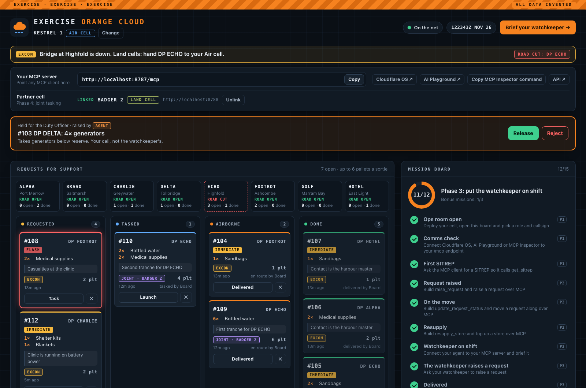
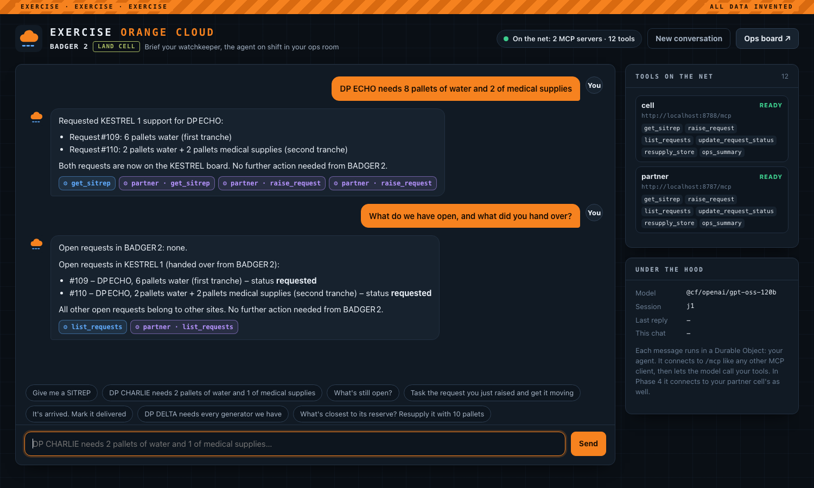

# Exercise ORANGE CLOUD

Hackathon starter for a two-hour hands-on session at Cloudflare London, 18 November 2026.

A storm has hit the island of Halcyon, and eight distribution points need water, shelter and medical stores. You run an ops room for the relief effort, on a single Cloudflare Worker. It already has a REST API, a live ops board and a database. This afternoon you give it an MCP server, put an AI watchkeeper on shift to run it, then link up with another cell so your two agents can hand work to each other.

The island, the storm and every number in here are invented.

[](https://deploy.workers.cloudflare.com/?url=https://github.com/GoncaloLeitao/exercise-orange-cloud)



## The afternoon

The guided path has four phases and takes about 75 minutes. Each phase has a target time, and one command skips ahead if you get stuck. Follow [docs/guide.md](docs/guide.md).

After that the time is yours until ENDEX at 16:20. Build your own idea in Cloudflare OS, on top of your ops room or from scratch. [docs/ideas.md](docs/ideas.md) has prompts and links to get you going.

You work in pairs. Exercise control (EXCON) tells each pair whether to stand up an Air cell or a Land cell, walks the room, and now and then sends an inject to keep things interesting. The [cheat sheet](CHEATSHEET.md) has every URL and command on it.

## Get your ops room running

You need a free Cloudflare account ([sign up here](https://dash.cloudflare.com/sign-up)). To work on your laptop you also need Node.js 22 or later and Git.

### Option A: from your laptop

```sh
git clone https://github.com/GoncaloLeitao/exercise-orange-cloud.git
cd exercise-orange-cloud
npm install
npx wrangler login
npm run deploy
```

Wrangler prints your URL, something like `https://ops-room.<your-subdomain>.workers.dev`. On a brand-new account it asks you to pick a `workers.dev` subdomain first. Any name will do.

`npm run dev` runs the same thing locally at http://localhost:8787. Your watchkeeper's model runs on Workers AI in your account even in local dev, so you still need to be logged in.

### Option B: the Deploy button

1. Click **Deploy to Cloudflare** above and log in to Cloudflare.
2. Connect GitHub or GitLab. Cloudflare copies this repo into your account, then builds and deploys it. The defaults are fine.
3. When it finishes, open your Worker's URL. That's your ops board.
4. To change the code, clone your new repo, edit, commit and `git push`. Every push to `main` redeploys in about a minute.

Either way, open the ops board first and pick your role and callsign.

## What's inside

```
                        one Worker: src/index.ts
  browser      ──▶  /           ops board              public/index.html
  browser      ──▶  /chat       brief the watchkeeper  public/chat.html
  curl, apps   ──▶  /api/*      REST API               src/ops/api.ts
  MCP clients  ──▶  /mcp        your MCP server        src/mcp.ts     ◀ Phase 2
  the chat UI  ──▶  /agents/*   your watchkeeper       src/agent.ts   ◀ Phases 3 and 4
                        │
                        ▼
      OpsRoom: a Durable Object with SQLite (stores, requests, sites, missions)
```

The watchkeeper is built with the [Agents SDK](https://developers.cloudflare.com/agents/). Every chat session gets its own agent instance, which is a Durable Object, so it remembers the conversation. It reaches your MCP server over its public URL, exactly as Cloudflare OS or Claude would, and thinks with a model on [Workers AI](https://developers.cloudflare.com/workers-ai/). In Phase 4 it connects to a second MCP server, your partner cell's, and works across both.

You only need to edit `src/mcp.ts` and `src/agent.ts`. Everything in `src/ops/` is plumbing: have a read, but you don't have to change it.



## How the exercise works

| | Air cell | Land cell |
|---|---|---|
| Moves stores by | sortie | convoy |
| One request carries | up to 6 pallets | up to 24 pallets |
| Can reach | any distribution point | points whose road is open |
| Stops when | flying is suspended | never, but a cut road blocks that point |

A request for support is a load of stores for one distribution point. It moves `requested → tasked → en_route → delivered`.

Every store has a reserve. A request that would take a store below its reserve is held, and only a human can release it, with a button on the ops board. The watchkeeper has no tool for that, on purpose.

## The phases

| | Goal | Where | Stuck? |
|---|---|---|---|
| 1 | Deploy, pick a role and callsign, connect an MCP client and call `get_sitrep` | nothing to edit | wave at exercise control |
| 2 | Build four MCP tools: `raise_request`, `list_requests`, `update_request_status`, `resupply_store` | `src/mcp.ts` | `npm run skip:mcp` |
| 3 | Connect the watchkeeper to your MCP server and brief it at `/chat` | `src/agent.ts` | `npm run skip:agent` |
| 4 | Link to your partner cell and hand it a request your cell can't deliver | ops board, `src/agent.ts` | `npm run skip:joint` |

The mission board on your ops board ticks itself off as you go, and the big screen shows every ops room in the exercise.

## Commands

| Command | What it does |
|---|---|
| `npm run dev` | Run your ops room locally at http://localhost:8787 |
| `npm run deploy` | Deploy to Cloudflare |
| `npm run smoke -- <url>` | Health check for the API and MCP server. Add `--write` to test the write tools and `--agent` to ask the watchkeeper a question |
| `npm run check` | Type-check the project |
| `npm run skip:mcp` | Drop in a finished `src/mcp.ts` (Phase 2) |
| `npm run skip:agent` | Drop in a finished `src/agent.ts` for Phase 3, with the Phase 4 TODO still yours |
| `npm run skip:joint` | Drop in a finished `src/agent.ts` for Phase 4 |
| `npm run skip:all` | Phases 2 to 4 |
| `npm run skip:stretch` | All of that, plus the stretch goals |
| `npx wrangler tail` | Stream live logs from your deployed Worker |

The skip commands back your file up to `src/*.ts.bak` first, so you never lose work.

## The model and the free plan

The watchkeeper uses `@cf/openai/gpt-oss-120b`, set in `wrangler.jsonc` under `vars.MODEL`. It's quick and dependable at calling tools. A simple reply costs about 130 Neurons and a joint hand-over about 400, so the free plan's 10,000 Neurons a day cover roughly 40 to 70 replies. The chat page shows the tokens each reply used.

Model speed on a shared service varies through the day. If a call to the first model takes more than 12 seconds or fails, the model in `vars.MODEL_FALLBACK` (`@cf/google/gemma-4-26b-a4b-it`) answers instead, and stays on for three minutes. Your ops board's log says when that happens, and the chat page shows which model answered. The fallback is slower on a good day but costs about 40% as much, so if you're running low on Neurons, set `MODEL` to it.

## Using an AI coding assistant

Go ahead. `AGENTS.md` (plus `CLAUDE.md`, a Cursor rule and Copilot instructions) asks assistants to coach you through the TODOs rather than paste the answers, so you still learn how it works. If you want the finished version, the skip commands are there for that.

## When something goes wrong

- **Deploy to Cloudflare says "Failed to get repository contents".** Try again in a private window, off any VPN. If it still fails, skip the button: clone the repo and run `npm install`, `npx wrangler login` and `npm run deploy`.
- **The watchkeeper says it isn't on the net.** You haven't finished Phase 3, or you haven't deployed since. See [the guide](docs/guide.md#phase-3-put-the-watchkeeper-on-shift).
- **New tools don't show up.** Cloudflare OS checks for new tools every 5 minutes: wait, then start a new chat. In AI Playground, open **Custom MCP → Tools** and select **Refresh**.
- **A request is stuck as "held".** It dips into a reserve. Release or reject it with the buttons at the top of your ops board.
- **Error 1042** means the `global_fetch_strictly_public` flag is missing from `wrangler.jsonc`. The watchkeeper needs it to call your Worker's public URL, and your partner's.
- **"You've used today's free Workers AI allowance".** It's per account and resets at midnight UTC. Deploy from your teammate's account.
- **Anything else:** run `npm run smoke -- <your-url>` and `npx wrangler tail`, then check the [troubleshooting table](docs/guide.md#troubleshooting).

## More

- [docs/guide.md](docs/guide.md): the guided path, step by step
- [docs/ideas.md](docs/ideas.md): your own mission, stretch goals and reference links
- [docs/facilitators.md](docs/facilitators.md): notes for exercise control, including how to run the injects and the big screen
- [CHEATSHEET.md](CHEATSHEET.md): every URL and command on one double-sided sheet ([PDF](docs/cheatsheet.pdf))
- [excon/](excon): the exercise control Worker. Attendees don't deploy it
- [cloudflare-os/skills](cloudflare-os/skills): a skill for the event's Cloudflare OS, so its agent knows the ops room's tools and rules
