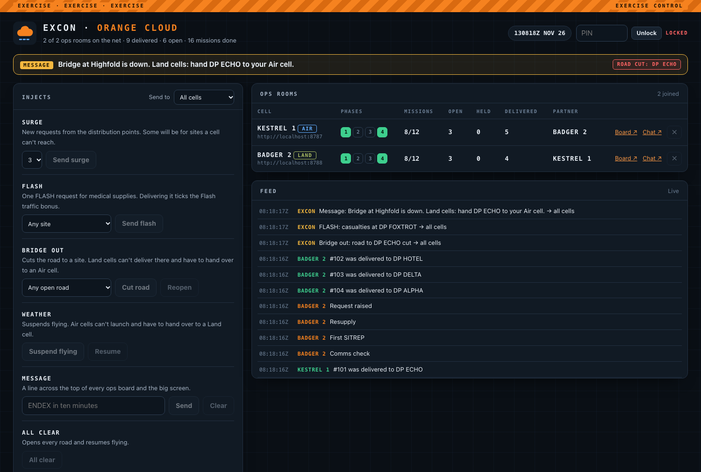
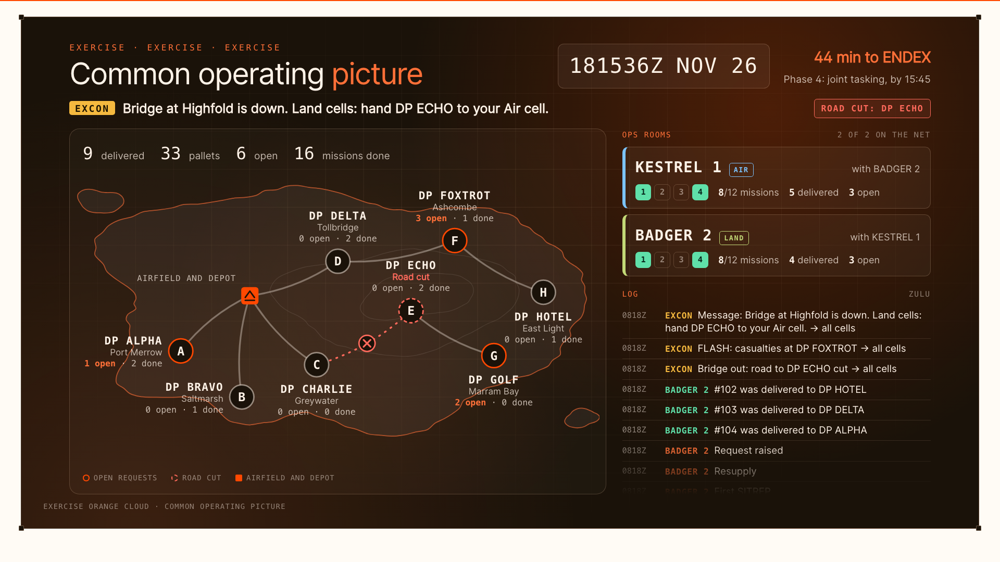

# Notes for exercise control

For the people running the room. Attendees don't need this page, but nothing here is secret.

The session is two hours for about eight developers, in pairs: 75 minutes on the guided exercise, then about 35 minutes on their own ideas, then a ten-minute debrief. Two things are new compared with the Workers Caff: a hub Worker that we run (exercise control, EXCON), and the big screen that reads from it.

## Before the day

Set these first. Each one is a placeholder until you've checked it.

| What | Where it is set | Now |
|---|---|---|
| Starter repo URL | README, guide, cheat sheet, `docs/cheatsheet.html`, the deck's `event.ts` and its QR code | `github.com/GoncaloLeitao/exercise-orange-cloud` |
| EXCON's address | `vars.EXCON_URL` in `wrangler.jsonc`, and `excon` in the deck's `event.ts` | `https://orange-cloud-excon.jleitao.workers.dev` |
| Cloudflare OS hostname | `public/index.html` (the button on the board), guide, ideas, cheat sheet, the deck's `event.ts` and its QR code | `cfos.cfevents.dev` |
| Timings | guide, cheat sheet, and the deck's `event.ts` | 14:30 start, ENDEX 16:20, close 16:30 |

Then:

- [ ] Deploy EXCON and set its PIN (see [Running EXCON](#running-excon)). It has to be reachable from the internet without Cloudflare Access in front of `/api/*`: attendees' Workers call it, and it calls them. An account with a default-deny Access policy won't do: every request gets error 1050 until someone adds an Access application.
- [ ] Make the repo public (**Settings → General → Danger Zone → Change visibility**). The Deploy button only works on public repos. There are no customer names in it.
- [ ] Test the Deploy button once the repo is public, ideally with an account that has never used Workers.
- [ ] Add the attendees' email addresses to the Access policy for the event's Cloudflare OS, and check which models they can use.
- [ ] Add `cloudflare-os/skills/ops-room-watchkeeper/SKILL.md` to the Cloudflare OS Context Library, so its agent knows the ops room's tools and rules.
- [ ] Deploy two reference ops rooms of your own, one Air and one Land, with `npm run skip:stretch`, and link them as partners. They are your demo, and they prove EXCON and the big screen work. Keep the URLs off slides: anyone with the URL can change them.
- [ ] Deploy the deck (`npm run deploy:orange-cloud` in the deck repo), give its hostname an Access application, and open both pages on the presenting laptop.
- [ ] Print the [cheat sheet](cheatsheet.pdf): one per person plus spares.
- [ ] Check the room's Wi-Fi reaches `github.com`, `registry.npmjs.org`, `*.workers.dev`, the Cloudflare OS hostname and `playground.ai.cloudflare.com`. Ask in advance whether their dev laptops can install from npm and deploy to a personal Cloudflare account. If not, the Deploy button and GitHub's web editor are the route.
- [ ] Decide the pairs, which are Air and which are Land, and who partners whom. You want as many Air cells as Land cells, each Air cell partnered with a Land cell.
- [ ] Agree the prize categories and who's judging.
- [ ] If anyone has to step out during the session, plan around it. Pairs mean no ops room goes quiet.

On the morning, reset the reference ops rooms (the `curl` command at the bottom of this page) and select **Forget every ops room** in the EXCON console.

## Useful links

| What | Where |
|---|---|
| Starter repo | https://github.com/GoncaloLeitao/exercise-orange-cloud |
| EXCON console | the root of the EXCON Worker, with the PIN |
| The big screen | page 2 of the deck. It reads `<EXCON>/api/cop` |
| The event's Cloudflare OS (main MCP client) | https://cfos.cfevents.dev |
| AI Playground (backup) | https://playground.ai.cloudflare.com/models |

## Run of show

| Time | What happens | Injects from EXCON |
|---|---|---|
| 14:30 | Orders, five minutes: the scenario, pairs and roles, the cheat sheet, how to get help. Deck page 1 is up | |
| 14:35 | Everyone deploys. Walk the room: sign-up and the first deploy are where people get stuck | |
| 14:50 | Phase 1 target. Switch the screen to page 2 so teams see themselves appear. If several pairs are stuck, demo connecting Cloudflare OS (**Gatekeepers → MCP Server**) | Message: "All cells on the net. Phase 2." |
| 15:00 | | Surge, 3 requests, all cells. Gives the Phase 2 tools something to work on |
| 15:15 | Phase 2 target. Suggest `npm run skip:mcp` to anyone still on the first tool | Flash, all cells |
| 15:30 | Phase 3 target. Suggest `npm run skip:agent` to anyone behind. Tell the pairs who their partner cell is and get them to swap URLs | Bridge out at DP ECHO, all cells. Message: "Bridge at Highfold is down. Land cells: hand DP ECHO to your Air cell." |
| 15:35 | | Surge, 3 requests, all cells. Some will be for DP ECHO |
| 15:40 | | Weather: suspend flying. Now Air cells need their Land partner. Resume after five minutes |
| 15:45 | Phase 4 target. Suggest `npm run skip:joint` to anyone behind. From here it's their own mission | All clear |
| 16:00 | Judges walk round. There's no submission form: judging is informal, at the tables | A flash or a surge now and then, to anyone whose agent looks idle |
| 16:10 | | Message: "ENDEX in ten minutes." |
| 16:20 | ENDEX. Hot debrief: a minute per pair to show what they built, then prizes | Message: "ENDEX. Tools down." |
| 16:30 | Close | |

The injects are a script, not a contract. If the room is behind, hold them. The one that matters is the bridge at 15:30, because Phase 4 needs a request a Land cell can't deliver.

## Orders, in about two minutes

> A storm has hit the island of Halcyon. Eight distribution points need water, shelter and medical stores, and you're running the ops rooms that get them there.
>
> You're in pairs. Each pair stands up one ops room on Cloudflare, in your own free account. Half of you are Air cells: you can reach anywhere, but a sortie lifts six pallets and you're grounded when the weather closes in. The other half are Land cells: a convoy carries twenty-four pallets, but only where there's a road. I'll tell each pair which they are.
>
> There are four phases. Stand up the ops room. Build its MCP server, so an AI can use it. Put a watchkeeper on shift: your own agent, running the ops room for you. Then joint tasking: link to your partner cell, so your agent can hand work to theirs. Every phase has a skip command, so nobody gets stuck for long.
>
> Two things to know. When a request dips into your reserve stock, the agent can't release it. Only you can, on the board. And we're exercise control: we'll send you injects. A bridge will go out. You have been warned.
>
> About quarter to four the exercise loosens up and the time is yours: build your own idea in Cloudflare OS. ENDEX is at twenty past four, then a hot debrief and prizes. Everything you need is on the cheat sheet. No duff: if something is really broken, wave.

## Pairs, roles and partners

Each pair opens its board and picks its own role and callsign. Changing role later swaps the stores and clears the requests, so settle it at the start.

Partners are set on the board by pasting the other cell's URL. The link is one-way: both cells have to do it. With four pairs that makes two task forces of one Air and one Land cell. With an odd number of cells, link one of your reference ops rooms to the spare. Two cells of the same kind can link too, and it works, but they share the same limits so there is less to hand over.

The ops room also works with nobody else in the exercise. If EXCON is down or `EXCON_URL` is empty, everything on the guided path still works, and teams can run their own injects from the board.

## Helping at a table

If the Deploy to Cloudflare button fails for someone ("Failed to get repository contents", or no GitHub account), don't debug it: move them to the clone and `npm run deploy` route. It only needs Node.js 22+ and Git.

Work through these in order:

1. **Does the board load** at `https://<their-worker>/`? If not, the deploy didn't happen. Check the output of `npm run deploy`, or the build log in the Cloudflare dashboard if they used the Deploy button.
2. **Where are they?** The mission board shows which phase they've reached. So does the EXCON console, for every cell at once.
3. **Run the smoke test:** `npm run smoke -- https://<their-worker> --agent`. It checks the API, lists their MCP tools, counts the Phase 2 tools and asks the watchkeeper a question. It also prints which MCP servers the watchkeeper is connected to, which settles most Phase 4 questions.
4. **Read the logs:** `npx wrangler tail`, or the Worker's **Logs** tab in the Cloudflare dashboard. Observability is on.

Problems you're likely to see:

| Symptom | Likely cause and fix |
|---|---|
| Can't deploy: no `workers.dev` subdomain | New accounts need one. Wrangler asks for it on the first deploy. Any name works. |
| `npm install` fails on Node version | Node 22 or later is required. Use `nvm install 22`, or switch to the Deploy button and GitHub's web editor (press `.` on their repo). |
| Locked-down laptop, no npm | Deploy button, then edit in GitHub's web editor. Every commit to `main` redeploys. |
| The watchkeeper talks but never uses tools | Phase 3 not finished, or not deployed since. The chat header shows how many MCP tools it can see. |
| "Couldn't use an MCP server" | Their `src/mcp.ts` fails to build a server. Usual suspects: a tool registered twice, or a syntax error. The smoke test shows the error. |
| Error 1042 | They removed `global_fetch_strictly_public` from `wrangler.jsonc`. The watchkeeper needs it to call the Worker's own public URL. |
| A request won't move | It's held. The orange bar at the top of the board has **Release** and **Reject**. Or it's for a cut road, or flying is suspended: that's an inject doing its job. |
| Phase 4: still one MCP server in the chat | The partner isn't linked on the board, TODO 3 isn't deployed, or it's an old conversation. **New conversation** fixes the last one. |
| Phase 4: the watchkeeper won't hand over | It needs a reason. Cut a road for a Land cell or suspend flying for an Air cell, then ask for a delivery it can't make. |
| Phase 4: handed over to the wrong cell | The partner changed their URL. Unlink and link again. |
| Can't sign in to Cloudflare OS | Only the addresses in the Access policy can get a code. Add them, and meanwhile they can use AI Playground. |
| Cloudflare OS doesn't change the ops room | Writes wait for approval. They need to press **Approve** in the chat for each request, status change and resupply. |
| Tools missing in Cloudflare OS | It re-reads the tool list every 5 minutes. Wait, then start a new chat. |
| Tools missing in AI Playground | **Custom MCP → Tools → Refresh** after each deploy. |
| AI Playground stops after 10 messages | A limit of the demo. Start a new chat, or move to Cloudflare OS. |
| Free Workers AI allowance used up | It's 10,000 Neurons a day per account and resets at midnight UTC. Get them to deploy from the other person's account. Cloudflare OS and AI Playground don't use their allowance. See [The model](#the-model). |
| Replies take a long time | The fallback model takes over by itself after one slow call. The board's log says "The watchkeeper's model is slow". See [The model](#the-model). |
| Not on the big screen | The cell joins EXCON when its board is open. Check the board's footer: "Reporting to EXCON" or "EXCON not reached yet". A cell running on localhost never joins an EXCON on the internet. |
| Missions don't tick for smoke tests | That's deliberate. Smoke traffic is labelled and ignored. |

## Judging

There's no leaderboard. The mission board and the big screen help you find tables to visit, but they aren't a score: a pair who skipped to Phase 4 and then built something original deserves more than a pair who ticked every box.

Things to reward:

- It works, live, when they show you.
- They added something the starter didn't give them. `npm run skip:stretch` drops in a reference for the stretch goals, so ask what they changed themselves.
- Their watchkeeper copes with injects without being told what to do.
- They built their own idea, in Cloudflare OS or anywhere on the platform.
- Character. A watchkeeper that reports in proper SITREP format counts.

Three prizes is plenty for eight people. Suggested categories: best watchkeeper, best joint tasking, best own mission.

## AI coding assistants

People will use Claude Code, Cursor, Copilot and friends, and that's fine. The repo has `AGENTS.md`, `CLAUDE.md`, `.cursor/rules/coach.mdc` and `.github/copilot-instructions.md`, which tell assistants to coach rather than paste answers from `solutions/`, and to point at the skip commands instead. Nothing stops someone who insists, and nothing needs to: the skip commands exist for exactly that.

## Cloudflare OS

The event's Cloudflare OS is the MCP client attendees should use all afternoon, and where most of them will build their own idea. AI Playground is the backup: it needs no sign-in, but it stops after 10 messages per chat.

To connect an ops room: open **Gatekeepers** in the sidebar, choose **MCP Server**, paste the deployed `/mcp` URL and select **Continue**, then ask for a SITREP. A localhost URL won't work: the ops room has to be deployed. Each connection is fixed to one URL. Reads such as `get_sitrep` go straight through. Anything that changes the ops room waits for their approval. New tools show up within about 5 minutes of a deploy.

The connect form only takes a URL, so once someone locks their `/mcp` with a bearer token (the "Lock the net" stretch), they'll need AI Playground's **Custom headers** to test it.

## Running EXCON



EXCON is the Worker in `excon/`. It keeps a list of the ops rooms that have joined, reads each one's public `/api/state` to build the common operating picture, and posts injects to their `/api/inject`. It stores no copy of their data beyond the last picture it read.

```sh
npm run excon:deploy
npx wrangler secret put EXCON_PIN -c excon/wrangler.jsonc
```

Deploy it to an account of ours, on a hostname the attendees' Workers can reach, then put that address in `vars.EXCON_URL` in the starter's `wrangler.jsonc` before the repo goes out. A plain `workers.dev` hostname is fine. Check it from outside with `curl <EXCON>/api/cop`: you want JSON back, not a login page or error 1050. For local testing, copy `excon/.dev.vars.example` to `excon/.dev.vars`, then `npm run excon:dev` runs it on http://localhost:8799. To point a local ops room at it, put `EXCON_URL=http://localhost:8799` in a `.dev.vars` file next to `wrangler.jsonc`.

| Path | What it does | PIN |
|---|---|---|
| `/` | The console: ops rooms, phases, injects, the feed | to act |
| `POST /api/join` | An ops room introduces itself. They do this by themselves when a board is open | no |
| `GET /api/cop` | The common operating picture, as JSON. The big screen and the console read it | no |
| `POST /api/inject` | `{ inject, target }` where target is `all`, `air`, `land` or one cell's URL | yes |
| `POST /api/remove`, `POST /api/reset` | Forget one ops room, or all of them | yes |

What the injects do:

| Inject | Effect on an ops room |
|---|---|
| Surge | As many new requests as you choose, up to six, from random distribution points. They leave the reserve alone. They arrive whatever the conditions, so some will be for a site the cell can't reach |
| Flash | One FLASH request for two pallets of medical supplies. EXCON tops the store up if it's short. Delivering it ticks **Flash traffic** |
| Bridge out / Reopen | Cuts or reopens the road to one site. A Land cell refuses new requests for a cut site and can't send anything there. Air cells are unaffected |
| Weather | Suspends or resumes flying. An Air cell refuses new requests and can't launch. Land cells are unaffected |
| Message | A line across the top of every board and the big screen |
| All clear | Opens every road, resumes flying |

Conditions sent to all cells become EXCON's own picture, which is what the map shows. A cell that joins late is sent the current conditions. Injects sent to one role or one cell aren't recorded as exercise-wide conditions.

The ops rooms' APIs are open, so a pair who reads the source can send injects to their neighbours. If that happens, enjoy it, then mention the "Lock the net" stretch. `/api/join` is open too: anything that answers like an ops room can add itself to the list, and the ✕ in the console removes it.

## The big screen



Two pages, in the deck repo under `src/events/exercise-orange-cloud`:

1. **Orders.** The brief under the five orders headings, how to get going, the QR code for the repo, a London clock with the date-time group in Zulu, and the phase timeline. It works as the holding screen for the whole session.
2. **Common operating picture.** The island with its eight distribution points, every ops room with its phases and counts, the conditions, and a log. It polls EXCON every three seconds.

Timings, hostnames and EXCON's address are in `components/event.ts`. Adding `?excon=<url>` to the deck's address points page 2 at a different EXCON without a rebuild, which is handy for a rehearsal against a local one.

## How the starter works

Enough detail to answer questions at the tables.

**One Worker does everything.** `src/index.ts` routes `/api/*` to the REST API, `/mcp` to the MCP server, `/agents/*` to the agent and everything else to static files in `public/`. The ops room's data lives in `OpsRoom`, a single Durable Object with SQLite. Role and callsign are stored there too, set from the board, so nobody edits config to get started.

**The MCP server** is built per request with `createMcpHandler` from the Agents SDK, using the official MCP TypeScript SDK. Tools call the store over Durable Object RPC. Every tool description starts with the cell's label, so a model holding two cells' tools can tell them apart.

**The watchkeeper** is an Agents SDK `Agent`, one instance per chat session. It connects to its own Worker's public `/mcp` URL with `addMcpServer`, just like an external client would. That's why the `global_fetch_strictly_public` compatibility flag is on: without it, a Worker calling its own hostname gets error 1042. In Phase 4 it adds the partner's `/mcp` as a second server. Both are added with a stable `id` (`cell` and `partner`), so the model sees tools named `tool_cell_raise_request` and `tool_partner_raise_request`. The model is `@cf/openai/gpt-oss-120b` on Workers AI. A typical reply takes 2 to 6 seconds on a good day. A message that hands work to a partner takes 6 to 13, because the agent makes four or five model calls. See [The model](#the-model) for the bad days.

**The reserve** is the human-in-the-loop piece. A request that would take a store below its reserve is saved as `held` and nothing leaves the stores. Only `POST /api/requests/:id/decision` releases it, and the client that MCP tools get has no method for that.

**Missions** tick from what the ops room sees. Every `/mcp` request is inspected in the background, and headers say who's calling:

| Header | Treated as |
|---|---|
| `x-cell-client: agent`, same origin | Their own watchkeeper |
| `x-cell-client: agent`, different `x-cell-origin` | A partner cell's watchkeeper. `x-cell-callsign` names it |
| `x-cell-client: smoke` | The smoke test (ignored) |
| `x-cell-client: excon` on `/api/*` | Exercise control |
| Anything else | An MCP client such as Cloudflare OS or AI Playground |

| Mission | Ticks when |
|---|---|
| Ops room open | A role and callsign are picked on the board |
| Comms check | An MCP client lists tools |
| First SITREP | An MCP client calls any tool |
| Request raised / On the move / Resupply | A request is raised, moved along or a store resupplied over MCP (client or agent) |
| Watchkeeper on shift | The watchkeeper replies with at least one MCP tool available |
| The watchkeeper raises a request | The watchkeeper raises a request |
| Delivered | The watchkeeper marks delivered a request that it raised |
| Sunray's say-so | A human releases or rejects a held request |
| Link established | Their watchkeeper connects to the partner's MCP server, or a partner's watchkeeper uses theirs |
| Joint tasking | Their watchkeeper raises a request with the partner, or a partner's raises one with them |
| Flash traffic | A FLASH request is delivered |
| Standing orders | A scheduled task reports in |
| Field modification | Any client calls a tool the starter doesn't include |

**Known quirks**

- The watchkeeper's memory belongs to one chat session. **New conversation** on the chat page starts a fresh agent, and is the way to pick up a new partner link.
- The first message after a deploy can take a few extra seconds while the watchkeeper reconnects.
- Open models occasionally slip: they answer with their own reasoning, print a tool call as text, loop on a word, or report a request number the ops room never issued. The kit checks each reply for those, retries once if nothing was changed, and otherwise says "Say again? That one came through garbled." Asking again works.
- The stretch reference runs a stores check every two minutes on one extra agent instance called `duty`, however many chats are open. It stops itself after an hour with no chat, and it only calls MCP tools, so it doesn't use any Workers AI allowance. It also resupplies anything at reserve, which makes held requests rarer on the reference ops rooms.
- If a pair runs `npm run skip:stretch` and later goes back to their own `src/agent.ts`, the `duty` instance's schedule keeps firing and logs "callback storesCheck not found" every two minutes. It's harmless noise in their logs.
- EXCON marks a cell "off the net" after 25 seconds without an answer. A cell whose Worker was deleted stays in the list until you remove it.

## The model

The watchkeeper thinks with `@cf/openai/gpt-oss-120b` on Workers AI, in each pair's own account. On 13 November I ran the same five jobs against every free-plan model with function calling that isn't being retired this month: read the SITREP, raise a two-line request and deliver it, hit the reserve, ask for a store that doesn't exist, and hand a load to a partner cell in sorties of six. Each job was checked against what landed on the boards, not what the model said.

| Model | Jobs passed | Typical reply | Slowest | Neurons a job |
|---|---|---|---|---|
| `@cf/openai/gpt-oss-120b` | 20 of 20 | 4 s | 16 s | 300 |
| `@cf/google/gemma-4-26b-a4b-it` | 19 of 20 | 10 s | 30 s | 115 |
| `@cf/qwen/qwen3.8-27b` | 18 of 20 | 11 s | 48 s | 650 |
| `@cf/daily-co/phonellm-mini-alpha-2` | 14 of 20 | 3 s | 8 s | not priced |
| `@cf/meta/llama-4-scout-17b-16e-instruct` | 8 of 20 | 10 s | 31 s | 395 |
| `gpt-oss-20b`, `glm-4.7-flash`, `llama-3.3-70b`, `mistral-small-3.1`, `granite-4.0-h-micro` | 3 or 4 of 5 | | | |

The failures were the kind that matter in the room: tool calls printed as text, loads that lost pallets when split, a different store quietly substituted for the one asked for. So `gpt-oss-120b` stays, with `gemma-4-26b-a4b-it` behind it.

Speed is the risk. The same model that answers in a second or two took 4 to 25 seconds a call late on 12 November, which made replies take over a minute, and `glm-4.7-flash` was the slow one the morning after. It varies by model and by hour. The kit deals with it: if a call to the first model takes more than 12 seconds or fails, the model in `vars.MODEL_FALLBACK` answers instead and stays on for three minutes, then the first model gets another go. The board's log says when it happens and the chat page shows which model answered. Nobody has to redeploy.

To re-test on the morning, point the model check at your two reference ops rooms. It resets them, runs the five jobs with whatever model they're deployed with, and prints what passed and how long each reply took:

```sh
npm run modelcheck -- https://<air-reference> https://<land-reference>
```

The free allowance is 10,000 Neurons a day per account. With `gpt-oss-120b` a simple reply costs about 130 and a joint hand-over about 400, so a busy pair can get through most of it in a session. If a pair looks like running out, have them set `vars.MODEL` to the fallback, which costs about 40% as much, or deploy from the other person's account.

## Resetting an ops room

**Reset ops room** on the board restores the stores and clears requests but keeps the mission board, the callsign and the partner. To wipe everything:

```sh
curl -X POST https://<worker>/api/reset -H 'content-type: application/json' -d '{"everything":true}'
```
